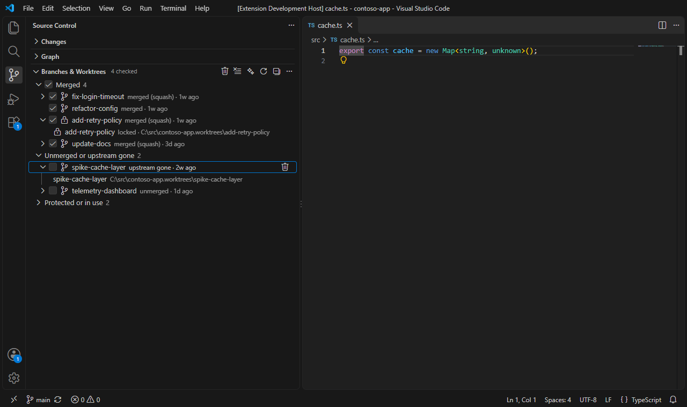
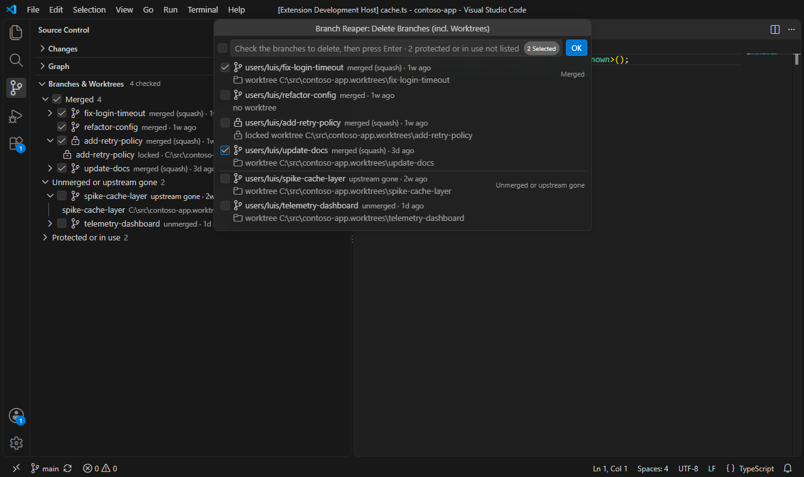
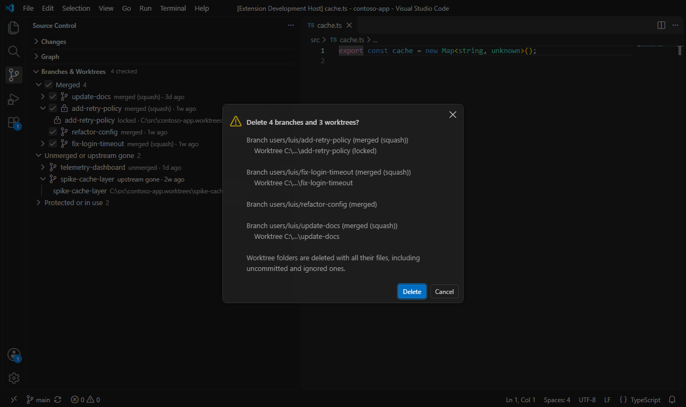
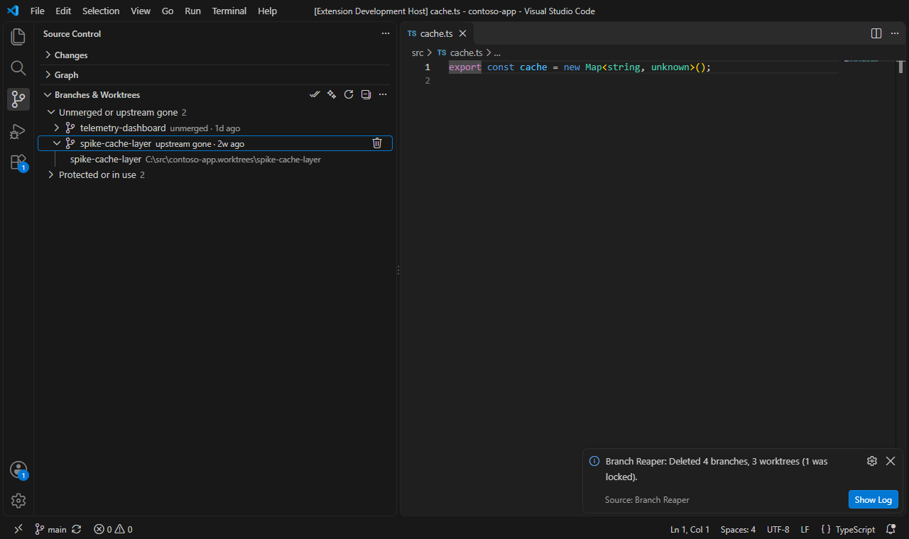
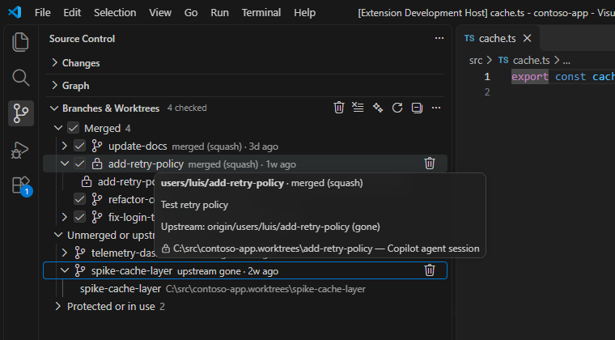

# Branch Reaper

**Delete a git branch and all of its worktrees in one click**, even when worktrees are locked,
have uncommitted changes, or are open in another VS Code window. Also cleans up merged and
squash-merged branches in bulk.

Built for running several AI agent sessions in parallel, each in its own worktree. Once their pull
requests merge, cleaning up used to mean finding every worktree, unlocking it, closing the window
or terminal that still used it, and only then deleting the branch.



## Features

- **Delete Branch…** (*Branch Reaper: Delete Branch…*, `Ctrl+Alt+Shift+D`, `Cmd+Alt+Shift+D` on
  macOS): check one or more local branches and press `Enter`; `Enter` without checking anything
  deletes the highlighted branch. Branches are listed in two sections, *Merged* and *Unmerged or
  upstream gone*, oldest last commit first. Each item shows
  - the branch name and the age of its last commit,
  - its worktrees and their paths, with a lock icon for locked worktrees,
  - its merge status: *merged*, *merged (squash)*, *upstream gone* (the remote branch was deleted,
    but its changes were not found in the default branch) or *unmerged*.

  The list opens instantly with the branches loaded last time and updates while it is open.

  

- **One confirmation** that lists exactly what will be removed: the worktree folders (marked
  *locked* or *uncommitted changes*), the local branch, the remote branch (see
  `branchReaper.deleteRemote`), and the VS Code windows that will be closed or lose a folder.
  After that, everything happens without further prompts.

  

  

- **Clean Up Merged Branches** (*Branch Reaper: Clean Up Merged Branches*): runs
  `git fetch --prune`, then offers every branch that is
  1. merged into the default branch (`git branch --merged origin/<default>`) or into another
     target branch (see `branchReaper.targetBranches`, for example `preview` or `release/1.5`),
  2. or whose upstream is `[gone]` (deleted after a pull request merged, which catches squash
     merges such as Azure DevOps' default),
  3. or, optionally, whose changes are already in one of those branches (empty tree diff, or a
     merge that would not change it). The status then says where, for example *merged (squash)
     into release/1.5*.

  All branches are checked (oldest first), except those with a worktree that has uncommitted
  changes (it may belong to an agent session that is still running) and those whose upstream is
  gone but whose changes were not found in the default branch. Uncheck the ones to keep.

- **Branches & Worktrees view** in the Source Control side bar (`Ctrl+Shift+G`; if it is hidden,
  enable it in the `…` menu → *Views*): local branches grouped into *Merged*, *Unmerged or
  upstream gone* and *Protected or in use*, oldest last commit first, with merge status, last
  commit age, worktrees and lock state. Long branch names are shortened to their last segment
  (`users/luis/new-feature` shows as `new-feature`, with more segments if two branches would
  look alike); hover a branch to see its full name, upstream and worktrees. Branches whose
  upstream is gone are under *Unmerged* on purpose: their changes were not found in the default
  branch, so check them before deleting.
  - **Check** the branches to delete (checking the *Merged* group checks all of its branches, as
    does the toolbar's *Check All Merged Branches*; *Unmerged or upstream gone* branches can only
    be checked one by one), then click **Delete Checked Branches** in the toolbar: one
    confirmation for all of them. The view's title shows how many are checked.
  - Inline buttons delete a single branch or open a worktree in a new window; the toolbar also
    has *Clean Up Merged Branches* and *Refresh*.

  

- **Source Control Repositories view**: *Delete Branch (incl. Worktrees)* in the context menu of a
  repository deletes the branch of that worktree (for the main worktree, it opens the branch
  picker for that repository). VS Code does not yet let extensions add menu items to the branch
  and worktree items of that view, so they are in the Branches & Worktrees view instead.

- **Progress and log**: long operations show progress, every git command with its output goes to
  the *Branch Reaper* output channel, and a summary ends each run, for example *Deleted 3
  branches, 4 worktrees (1 was locked).*

Works on Windows, macOS and Linux, with multiple repositories per window and with windows opened
on a worktree (the repository is resolved with `git rev-parse --git-common-dir`).

## How it works

For each branch:

1. `git worktree prune`.
2. Read `git worktree list --porcelain -z` and select every worktree whose `branch` is
   `refs/heads/<name>` (locked, prunable and detached entries are handled).
3. Release the worktree folders in VS Code:
   - In this window, remove the workspace folders inside them and close the git repositories and
     terminals that work inside them.
   - Another VS Code window that has only folders inside them closes itself (unsaved changes to
     files inside the worktree are discarded, terminals and tasks are ended). A window that also
     has other folders only removes the affected ones. Every Branch Reaper instance registers its
     window in a temp folder, which is how they find each other, also across VS Code instances.
     Windows without Branch Reaper are found through VS Code's `storage.json` and listed in the
     confirmation so you can close them.
4. `git worktree remove --force --force -- <path>` (twice `--force` removes locked and dirty
   worktrees).
5. If the folder still exists (untracked or ignored files, or files in use on Windows), delete it
   recursively, retrying with backoff for `branchReaper.worktreeDeleteRetryMs`. If it still
   fails, find the processes using it and report them (on Windows with the Restart Manager API,
   the working directory of running processes, and `handle.exe`/`handle64.exe` if it is on the
   `PATH`; elsewhere with `lsof`). The leftover folder is detached from the repository so the
   branch is still deleted, then `git worktree prune` runs again.
6. `git branch -D <name>`.
7. Optionally `git push <remote> --delete <branch>` (see `branchReaper.deleteRemote`).

Never deleted: the main worktree, a branch checked out in the main worktree, the branch of this
window's repository (when its worktree holds all of this window's folders, or the first one),
the remote's default branch, and branches matching `branchReaper.protectedBranches`.

Git runs through `child_process.execFile` without a shell, using the git binary of VS Code's git
extension, so branch names are never interpreted by a shell.

## Settings

| Setting | Default | Description |
| --- | --- | --- |
| `branchReaper.protectedBranches` | `["main", "master", "release*", "releases/*"]` | Branches that are never deleted. Case-insensitive globs: `*` matches within a path segment, `**` across segments, `?` one character. |
| `branchReaper.targetBranches` | `["main", "master", "develop", "dev", "preview", "release*", "release/**", "releases/**", "hotfix/**"]` | Remote branches that pull requests merge into, besides the default branch. A branch merged into any of them counts as merged. Same glob syntax as `protectedBranches`. |
| `branchReaper.deleteRemote` | `ask` | `never`, `ask` (the confirmation has a *Delete incl. Remote* button) or `always`. Branches whose upstream is gone are not pushed. |
| `branchReaper.confirm` | `true` | Show the confirmation. When off, `ask` behaves like `never`. |
| `branchReaper.worktreeDeleteRetryMs` | `5000` | How long to retry deleting a worktree folder that is in use, in milliseconds. |
| `branchReaper.cleanUp.detectSquashMerged` | `true` | Also offer branches whose changes are already in the default branch or another target branch. |
| `branchReaper.cleanUp.fetch` | `true` | Run `git fetch --prune` before cleaning up. |
| `branchReaper.closeTerminals` | `true` | Close terminals (in any window) whose working directory is inside a worktree being removed. |

## Commands

| Command | Description |
| --- | --- |
| `Branch Reaper: Delete Branch…` | Check branches and delete them with all of their worktrees (`Ctrl+Alt+Shift+D`). |
| `Branch Reaper: Delete Checked Branches` | Delete the branches checked in the Branches & Worktrees view. |
| `Branch Reaper: Check All Merged Branches` / `Uncheck All Branches` | Check or uncheck branches in the view. |
| `Branch Reaper: Clean Up Merged Branches` | Fetch, then delete merged, squash-merged and gone branches. |
| `Delete Branch (incl. Worktrees)` | Context menu of the Branches & Worktrees view and of repositories in the Source Control Repositories view. |
| `Branch Reaper: Refresh` | Refresh the Branches & Worktrees view. |
| `Branch Reaper: Show Log` | Show the git commands that ran and their output. |

## Limitations

- Branch Reaper needs a trusted workspace, like VS Code's git extension.
- Windows connected to a remote (WSL, SSH, containers) only coordinate with windows on the same
  machine.
- Closing another window asks about unsaved changes to files outside the worktree, as usual.

## Install

Install it from the
[Visual Studio Marketplace](https://marketplace.visualstudio.com/items?itemName=luiscantero.branch-reaper),
search for **Branch Reaper** in VS Code's Extensions view, or run:

```powershell
code --install-extension luiscantero.branch-reaper
```

## Build from source

Requirements: Node.js 20+ and git.

```powershell
npm install
npm test          # unit tests, then integration tests in a downloaded VS Code
npm run package   # writes branch-reaper-<version>.vsix
code --install-extension branch-reaper-0.2.0.vsix
```

The VSIX contains only JavaScript, so the same file works on Windows, macOS and Linux, and one
upload to the Marketplace covers all of them.

To run the tests on Linux, use WSL (Ubuntu with `rsync`, Node.js 20+ and the libraries VS Code
needs, such as `libgtk-3-0t64`, `libnss3`, `libgbm1` and `libasound2t64`). From PowerShell:

```powershell
.\scripts\wsl-test.ps1   # copies the sources to ~/builds/branch-reaper and runs npm test there
```

The integration tests use WSLg's display, or `xvfb-run` if it is installed.

`BRANCH_REAPER_TEST_VSCODE` selects the VS Code used by the integration tests: a version such as
`insiders` or `1.100.0` (default `stable`), or the path of a VS Code executable.

For development, run `npm run watch` and press `F5` (*Run Extension*).

### Screenshots

`npm run screenshots` recreates the images in `images/`: it builds a demo repository in
`C:\src\contoso-app` (`/tmp/src` elsewhere, or `DEMO_ROOT`), opens it in a downloaded VS Code
with the extension, and removes it afterwards. The images are not packaged; the Marketplace
shows them from GitHub, so push them before publishing.

### Release

1. Set the new version (`npm version <x.y.z> --no-git-tag-version`), add it to `CHANGELOG.md`,
   and update the VSIX file name in the `code --install-extension` example above.
2. Commit as `Release v<x.y.z>`, tag it (`git tag -a v<x.y.z> -m v<x.y.z>`), and push the commit
   and the tag.
3. `npm test` and `npm run package` (optionally `.\scripts\wsl-test.ps1` to test on Linux).
4. Upload `branch-reaper-<x.y.z>.vsix` at
   [marketplace.visualstudio.com/manage/publishers/luiscantero](https://marketplace.visualstudio.com/manage/publishers/luiscantero)
   (or `npx vsce publish --packagePath branch-reaper-<x.y.z>.vsix`).

## Feedback

Report issues and ideas at
[github.com/luiscantero/BranchReaper/issues](https://github.com/luiscantero/BranchReaper/issues).
